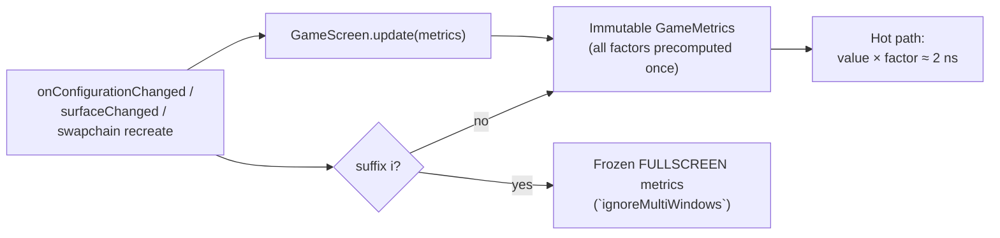

<div align="center">

# 🎮 AppDimens Games


### Responsive HUD/UI, viewports, cameras and upscaling for every game platform, engine and graphics API

**Windows · Linux · Steam Deck · Proton/Wine · macOS · iOS · Android · Web · consoles · XR**
**Unity · Unreal Engine 5 · Godot 4 · custom C/C++ engines · MonoGame/FNA/Stride · Android (Compose/Kotlin/NDK)**
**OpenGL / ES / WebGL · Vulkan · Direct3D 11/12 · Metal · WebGPU · FSR · DLSS · XeSS · MetalFX · TSR**

[](#)
[](LICENSE)
[](DOCUMENTATION/CROSS-PLATFORM.md)
[](DOCUMENTATION/ENGINES.md)
[](DOCUMENTATION/GRAPHICS-APIS.md)
[](DOCUMENTATION/UPSCALING.md)

[](DOCUMENTATION/GUIDE-FOR-BEGINNERS.md)
[](DOCUMENTATION/ENGINES.md)
[](DOCUMENTATION/GENRES.md)
[](DOCUMENTATION/README.md)

</div>

**AppDimens Games** answers the questions every shipped game has to answer on every screen: *how big is this HUD element
here? what do I render at? which FOV keeps my framing on 4:3, 16:9, 21:9, 32:9 and a portrait phone? which render
resolution, mip bias and jitter does DLSS/FSR/XeSS need? where is the safe area on this TV, notch or Steam Deck?* —
with the **same math as the whole AppDimens family**, **one multiply per size**, zero allocations and identical results
in C, C++, C#, GDScript, Kotlin and Java.

---

## 🌍 Platforms, engines and APIs (3.3.0)

| You ship with… | Use | Install |
|---|---|---|
| **Unity** (2019.4+; every platform incl. WebGL, consoles, XR) | UPM package — `AppDimensScreen`, `AppDimensCanvasScaler`, `AppDimensSafeArea`, `AppDimensCamera`, `AppDimensDynamicResolution`, `AppDimensUpscaling` | Package Manager ▸ git URL `https://github.com/bodenberg/appdimens-games.git?path=/bindings/unity/com.bodenberg.appdimens.games` |
| **Unreal Engine 5** | Plugin — UMG **DPI scaling rule**, `UAppDimensSubsystem`, Blueprint library (sizes, FOV, `r.ScreenPercentage` presets, LOD) | copy `bindings/unreal/AppDimens` into `Plugins/` |
| **Godot 4** (GDScript; C# via the .NET package) | Addon — `AppDimens` autoload, `content_scale_factor` UI scaling, FSR/FSR2/MetalFX `scaling_3d_mode`, FOV, safe area | copy `bindings/godot/addons/appdimens` |
| **Custom C/C++ engines** (SDL, GLFW, raylib, bgfx, sokol, Vulkan/D3D/Metal renderers) | header-only `native/include/appdimens/games.h` + optional thread-safe C ABI | `add_subdirectory(native)` → `AppDimens::games` / `AppDimens::games_headers` |
| **.NET** (MonoGame, FNA, Stride, Godot .NET, Unity) | `AppDimens.Games` (netstandard2.0, pure managed) | `bindings/csharp/AppDimens.Games` |
| **Rust · Zig · Python · Lua · Swift · Java (Panama)** | C ABI `appdimens_games` (`appdimens_games_api.h`) | shared library from `native/` |
| **Android** — Compose, Kotlin, Java, NDK | the existing Maven artifacts (below); the `.so` now also exports the C ABI | `io.github.bodenberg:appdimens-games:3.3.0` |

| Graphics API | Viewport | Projection | Notes |
|---|---|---|---|
| OpenGL / GLES / WebGL | `adg_gl_viewport` (y from bottom) | `adg_ortho/perspective(ADG_GFX_OPENGL…)` depth [-1, 1] | |
| Vulkan | `adg_native_viewport(v, flip_y)` = `VkViewport` (negative-height flip) | NDC Y down handled | layout `static_assert`ed against `vulkan.h` |
| Direct3D 11 / 12 | `adg_native_viewport` = `D3D11_VIEWPORT` / `D3D12_VIEWPORT`, `adg_rect_ltrb` = `D3D12_RECT` | depth [0, 1], `row_major` option | layout `static_assert`ed against `d3d11.h`/`d3d12.h` |
| Metal | `adg_metal_viewport` = `MTLViewport` (doubles) | depth [0, 1] | |
| WebGPU | `adg_native_viewport` = `setViewport()` args | depth [0, 1] | |

Reverse-Z and infinite far planes are supported for open worlds. Details: [GRAPHICS-APIS.md](DOCUMENTATION/GRAPHICS-APIS.md).

### One idea, every engine

```c
/* C / C++ — any engine */
adg_surface s; adg_surface_default(&s, swapchain_w, swapchain_h);   // REFERENCE mode, 1080p design
ad_metrics m;  adg_metrics_from_surface(&m, &s);
float bar   = adg_ref_px(&m, AD_AUTO, 320);       // 320 px at 1080p → px now (calm on 4K/ultrawide)
float cross = adg_ref_px(&m, AD_FIT, 24);         // never overflows on 32:9 or portrait
adg_viewport vp = adg_viewport_compute(ADG_VIEW_INTEGER, swapchain_w, swapchain_h, 320, 180); // pixel art
adg_render_size r = adg_upscale_render_size(ADG_UPSCALER_DLSS, ADG_Q_QUALITY, swapchain_w, swapchain_h);
float vfov = adg_fov_for_aspect(ADG_FOV_HYBRID, 60 * ADG_DEG2RAD, 16.f / 9, (float)swapchain_w / swapchain_h, 0);
```
```csharp
// Unity — components do the wiring; in code:
float bar = AppDimensScreen.Asdp(320);
AppDimensUpscaling.ApplyToPipeline(Upscaler.Fsr3, UpscaleQuality.Quality);
```
```gdscript
# Godot 4
var bar := AppDimens.asdp(320)
AppDimensGames.configure_3d_scaling(get_viewport(), AppDimensGames.Upscaler.FSR2, AppDimensGames.Quality.QUALITY)
```
```cpp
// Unreal — DPI rule drives UMG; in Blueprint/C++:
float Bar = UAppDimensLibrary::Asdp(320.f);
UAppDimensLibrary::ApplyUpscalerPreset(EAppDimensUpscaler::TSR, EAppDimensQuality::Quality);
```

### Platform matrix

| Platform | Notes |
|---|---|
| **Windows** (DirectX/Vulkan/GL) | Per-monitor DPI: `ADG_SCALE_CONTENT` with `GetDpiForWindow()/96`; games should prefer `ADG_SCALE_REFERENCE` (resolution-relative) |
| **Proton / Wine** | detected (`adg_platform()` → `ADG_PLATFORM_WINE`/`PROTON`); Wine reports 96 DPI, so REFERENCE mode keeps HUDs right regardless — verified by running the Windows test suite under Wine |
| **Steam Deck / SteamOS** | `ADG_PLATFORM_STEAMDECK` + `adg_suggest_device_class()` → handheld (1280×800, 16:10, ~7"): Hybrid FOV, handheld text minimums |
| **Linux** (X11/Wayland, x64/arm64) | fractional Wayland scale via CONTENT mode |
| **macOS / iOS / tvOS** | Metal viewports, backing scale, safe areas (notch, home indicator), tvOS overscan |
| **Android** | Maven artifacts + NDK; split-screen = multi-window (`i` tokens) |
| **Web** (Emscripten, WebGL/WebGPU) | static C ABI build; for DOM UIs use [webdimens](https://github.com/bodenberg/appdimens-web) |
| **Consoles** | plain C99/C++17, no OS calls in the header API; set `ADG_PLATFORM_CONSOLE` yourself |

See [CROSS-PLATFORM.md](DOCUMENTATION/CROSS-PLATFORM.md) · [UPSCALING.md](DOCUMENTATION/UPSCALING.md) · [ENGINES.md](DOCUMENTATION/ENGINES.md) · [GENRES.md](DOCUMENTATION/GENRES.md)

---

## 🤖 Android libraries (Compose · Kotlin · Java · NDK)

The sections below document the Android Maven artifacts, which keep the same API as 3.2.0.

## 🤔 What is it? (30 seconds)

**AppDimens Games answers one question for your game:** *"how big should this element be on THIS screen?"* — instantly, precisely and consistently across phones → foldables → tablets → TVs, in every stack you ship (Kotlin/Java/Compose/C/C++/C#).

```text
window resize ─▶ snapshot (all factors precomputed once)
                    └─▶ size = base × factor   ≈ 2 ns · zero alloc · per frame OK
```

- **Auto-adjust:** every value follows rotation/split-screen/fold resizes automatically.
- **`i` suffix = invariant:** HUD elements pinned to the frozen fullscreen reference.
- **Family math:** bit-exact with appdimens-dynamic 3.x / kmp 1.x — one vocabulary everywhere.

**Pick by element:** HUD→`sdp` · gameplay⭐→`asdp`(auto) · background→`flsdp`(fill) ·
board visible→`ftsdp`(fit) · text→`fsdp`(fluid) · TV→`logsdp` · physical touch→`dgsdp`/`cmPx`.

Full tutorial with copy-paste steps for each stack: **[GUIDE-FOR-BEGINNERS.md](DOCUMENTATION/GUIDE-FOR-BEGINNERS.md)** 📘

---

## 📦 Installation

```kotlin
implementation("io.github.bodenberg:appdimens-games:3.3.0")          // core
// Modular satellites (same shape as dynamic/kmp):
// appdimens-games-{auto,density,diagonal,fill,fit,fluid,interpolated,
//                   logarithmic,percent,perimeter,power,resize,units,custom*}
// *custom: unreleased — your own strategies (DOCUMENTATION/strategies/custom.md)
implementation("io.github.bodenberg:appdimens-games-native:3.3.0")   // C/C++/JNI + GL/VK/DX
implementation(platform("io.github.bodenberg:appdimens-games-bom:3.3.0"))
```

| Requirement | Version |
|---|---|
| minSdk / compileSdk | **24 / 37** |
| AGP / Kotlin / JDK (bytecode) | 9.3.1 / 2.4.10 / 17 |
| Gradle (build of this repo) | 9.5.0 (daemon JVM 25) |
| Jetpack Compose | any version — `compileOnly`, bring your own `compose-bom` |

---

## ⚡ Quick start — identical to appdimens-dynamic/kmp

### Kotlin (Views / game loops) — code side returns **px**

```kotlin
val hud    = 48.sdp(context)      // scaled by smallest width
val hudAr  = 48.sdpa(context)     // + aspect-ratio refinement (`a`)
val hudInv = 48.sdpi(context)     // 🔒 invariant under resized windows (`i`)
val w      = 100.wdp(context)
val h      = 200.hdp(context)
val text   = 16.ssp(context)      // scaled text (sp semantics)
val fixed  = 14.sem(context)      // fixed text (ignores font scale)
```

### Java — `DimenSdp` static facade (family parity)

```java
float hud = DimenSdp.sdp(ctx, 48);
float inv = DimenSdp.sdpi(ctx, 48);
float px  = DimenSdp.getDimensionInPx(ctx, DpQualifier.SMALL_WIDTH, 16,
                                      Inverter.DEFAULT, false, false, null);
```

### Builder — `scaledDp()` (family parity)

```kotlin
16.scaledDp()
  .aspectRatio(true)
  .screen(UiModeType.TELEVISION, 32)              // priority 2
  .qualifier(DpQualifier.SMALL_WIDTH, 600, 24)    // priority 3
  .sdp(context)                                    // terminal → px
```

### Facilitators — family parity

```kotlin
30f.sdpRotate(ctx, 44f, Orientation.LANDSCAPE)     // value per orientation
12f.sdpMode(ctx, 24f, UiModeType.TELEVISION)       // TV override
60f.sdpQualifier(ctx, 120f, DpQualifier.SMALL_WIDTH, 600)
70f.sdpScreen(ctx, 150f, UiModeType.TELEVISION, DpQualifier.SMALL_WIDTH, 600)
```

### Inverters — family parity

```kotlin
32.hdpLw(context)   // PH→LW: height behaves as width in landscape
32.wdpLh(context)   // PW→LH
32.sdpPh(context)   // SW→PH in portrait
```

### Escape hatches — family parity

```kotlin
val dp = 16f.toDynamicScaledDp(ctx, DpQualifier.SMALL_WIDTH, Inverter.DEFAULT,
                                ignoreMultiWindows = false, applyAspectRatio = false,
                                customSensitivityK = null)
val px = 16f.toDynamicScaledPx(ctx)
```

### Strategy satellites — same prefixes as the family

| Strategy | Stems | Example |
|---|---|---|
| percent | `psdp/phdp/pwdp` + `spaceW/Sw/H` | `10.spaceW(ctx)` |
| power | `pwsdp…` | `48f.pwsdp(ctx)` |
| fluid | `fsdp/fhdp/fwdp` | `16f.fsdp(ctx)` |
| auto ⭐ | `asdp/ahdp/awdp` | `64f.asdp(ctx)` — gameplay default |
| diagonal | `dgsdp…` | `48f.dgsdp(ctx)` |
| fill / fit | `flsdp…` / `ftsdp…` | backgrounds / viewports |
| interpolated | `isdp…` | `48f.isdp(ctx)` |
| logarithmic | `logsdp…` | `50f.logsdp(ctx)` |
| perimeter | `prsdp…` | `16f.prsdp(ctx)` |
| density | `dsdp…` | `16f.dsdp(ctx)` |
| custom *(unreleased)* | `cdp/csp` + your strategy | `CustomScaleStrategy { (width / 360f).coerceIn(0.85f, 1.8f) }` / `scalingFormula { base * pow(sw / 360f, 0.8f) }` (typed one-liners, autocomplete), text `64.cdp("base * …")` for JSON, or `64f.cdp(Hud)` — DSL/JSON, rules per device, free-form formulas → [custom.md](DOCUMENTATION/strategies/custom.md) · [full guide](DOCUMENTATION/strategies/custom/README.md) |

### Compose games — same stems, reactive

The library declares Jetpack Compose as `compileOnly` (`androidx.compose.runtime` + `androidx.compose.ui`) and never pins a version, so any Compose version works without conflict — declare your own `compose-bom` / Compose dependency in the game module.

```kotlin
AppDimensProvider {
    Box(Modifier.size(48.asdp)) {                 // library-auto satellite
        Text("SCORE", fontSize = 16.ssp, modifier = Modifier.padding(12.sdp))
        IconButton(Modifier.size(20.sdpi))        // 🔒 invariant HUD (`i`)
    }
}
```

### Native engines — C / C++ / NDK · OpenGL ES · Vulkan · DirectX

**How it works natively — 3 steps:** ① build+publish a snapshot on every resize (`Metrics::make` precomputes all factors; keep the object alive — the hub stores its address) → ② read `metrics()` once per frame (lock-free atomic load) → ③ size with single-multiply kernels + letterbox via `render::*`.

```cpp
#include "appdimens/games/core.h"   // Metrics::make / updateMetrics / metrics()
#include "appdimens/games/math.h"   // autoDp / scaledDp / toPx …
#include "appdimens/games/render.h" // glRect / vkViewport / dxViewport / ortho

// STEP ① — publish (onSurfaceChanged | swapchain recreate | ResizeBuffers):
static Metrics g_m;                                  // ⚠️ lifetime rule!
void OnResize(int wPx, int hPx, float dpi) {
    const float d = dpi / 160.f;
    g_m = Metrics::make(wPx/d, hPx/d, /*swDp*/0.f, dpi, 1.f, /*fullscreen*/true);
    updateMetrics(g_m);
}
// STEP ②+③ — per frame:
float playerPx = math::autoDp(64.f, metrics()) * metrics().density;   // BALANCED ⭐
float hudInv   = invariantMetrics().fullscreen                         // `i` invariant
                   ? math::scaledDp(48.f, invariantMetrics()) * metrics().density : 48.f;
auto vp = render::vkViewport(render::Mode::FitAll, surfW, surfH, 1920.f, 1080.f);
```

| Stack | You call | Tutorial |
|---|---|---|
| **OpenGL ES** | `glRect(FitAll…)` + `ortho(…)` + kernels | [Guide §5](DOCUMENTATION/GUIDE-FOR-BEGINNERS.md#5-tutorial-d--opengl-es-3x-c) |
| **Vulkan** | `VK_ERROR_OUT_OF_DATE_KHR` → republish + `vkViewport` | [Guide §6](DOCUMENTATION/GUIDE-FOR-BEGINNERS.md#6-tutorial-e--vulkan) |
| **DirectX 11/12** | `ResizeBuffers` → republish + `dxViewport` | [Guide §7](DOCUMENTATION/GUIDE-FOR-BEGINNERS.md#7-tutorial-f--directx-1112-windowsxbox-shared-code) |
| **Pure C (raylib/SDL)** | header-only `adg_*` API | [Native §2](DOCUMENTATION/NATIVE-GAME-ENGINES.md) |

**Unity/C#:** bootstrap + `MathKernels.Scaled/ScaledInvariant/Auto/Fit/Fill` + `World.ViewportRect(letterbox)` + `Units.CmToPx(2f)` + custom strategies `CustomScaleStrategy.Create(s => s.Clamp(s.Width / 360f, 0.85f, 1.8f))` / `CustomKernels.Cdp(64f, hud)` → [Guide §8](DOCUMENTATION/GUIDE-FOR-BEGINNERS.md#8-tutorial-g--unity-c) · deep dive [CSHARP-UNITY.md](DOCUMENTATION/CSHARP-UNITY.md) (uGUI, câmera letterbox, Godot 4, MAUI, DOTS/Burst).

---

## 🧠 Auto-resize architecture



## 📊 Performance contract

| Path | Cost |
|---|---|
| Fast lane dp→px | **~2 ns** (`base × factor`) |
| Kernel cold | 15–40 ns, allocation-free |
| Snapshot rebuild | once per resize (exact `ln()` only here) |

On-device comparison vs games-2.0.1 & dynamic-3.1.9: [`benchlab/`](benchlab) · [PERFORMANCE.md](PERFORMANCE.md).

## ✨ What's new in 3.3.0

- **Custom strategies in C/C++ and Unreal**: `native/include/appdimens/appdimens_custom.h` (also in the Unreal `ThirdParty/appdimens`) runs the shared JSON document and text formulas with `adc_dp(strategy, adg_acquire(), 64)`; see [DOCUMENTATION/CUSTOM-NATIVE.md](DOCUMENTATION/CUSTOM-NATIVE.md). Reproduces the 540-case fixture.

- **Cross-platform native SDK** (`native/`): Windows, Linux, Steam Deck, Proton/Wine, macOS, iOS, Android, Web, consoles.
- **Engines:** Unity UPM package, Unreal Engine 5 plugin (UMG DPI rule), Godot 4 addon, .NET package (MonoGame/FNA/Stride).
- **Graphics APIs:** native viewports/scissors/projections for OpenGL(ES)/WebGL, Vulkan, D3D11/12, Metal, WebGPU — reverse-Z, infinite far.
- **Upscalers:** FSR 1/2/3, DLSS, XeSS, MetalFX, TSR, PSSR, SGSR presets → render size, mip bias, Halton jitter; dynamic resolution.
- **Cameras:** Hor+/Vert-/hybrid FOV, ultrawide caps, 2D orthographic size, FOV-consistent sensitivity.
- **HUD:** safe areas, TV overscan, ultrawide HUD band, minimum text/touch sizes; **LOD** helpers for open worlds.
- **Fixes:** the NDK snapshot publication no longer exposes a `thread_local` buffer that was overwritten in place (torn
  reads across threads); `render::ortho()` now produces correct OpenGL depth terms.

## ✨ What's new in 3.2.0

| Change | Detail |
|---|---|
| 🧩 **Compose version independence** | Compose is `compileOnly` (`runtime` + `ui`); the published AAR/POM pins **no** Compose version. Your app's Compose is the only runtime — no skew, no "class not found". Declare your own `compose-bom`. |
| 🎯 `WorldScale` = viewport math | `WorldScale.fitPx`/`fillPx` now use exactly `min`/`max(windowW/designW, windowH/designH)` — identical to `ViewportMode.FIT_ALL` / `CROP`, so sprites and letterbox agree pixel-for-pixel in any orientation. Native `math::scaleVecFit` follows the same rule. |
| 🛡️ Native robustness | `Metrics::make` guards `ln()` against a zero dimension; built with `-fno-fast-math` (strict IEEE, bit-parity with the JVM kernels). |
| 🧪 Test coverage | New JVM suites for `GameCache`, `GameMetrics`, `GameScreen`, `GameWorld`, code API, physical units and resize math. |
| 🧰 Build | Gradle 9.5.0 · AGP 9.3.1 · Kotlin 2.4.10 (Compose plugin aligned on the root classpath). |

## ✨ What's new in 3.0.0

| Change | Detail |
|---|---|
| 🧬 **Family-standard API** | Same extensions/stems/suffixes/facilitators/builders as dynamic 3.x & kmp 1.x — one learning curve for the whole family. |
| 🔁 Bit-exact kernels | Oracle-validated parity with dynamic/kmp (`scripts/oracle.py`, 30 cases). |
| 🚀 Snapshot engine | Precomputed factors replace legacy hash-per-call gateway (~10–50× faster than 2.0.1 paths). |
| 🔒 `i` for games | `ignoreMultiWindows` anchors to frozen fullscreen metrics under split-screen/freeform. |
| ⚙️ True native layer | Header-only C++20 core + pure C99 header + JNI; GL/Vulkan/DirectX viewport interop. |
| 🧱 Game world layer | Vec2/Vec3, Rect, ViewportMode letterbox/crop, world↔screen mapping. |
| 🧰 Toolchain | AGP 9.x · compileSdk 37 · Kotlin 2.x — aligned with the family. |

## 📚 Documentation

[DOCUMENTATION/README.md](DOCUMENTATION/README.md) (index + decision flow) · [GUIDE-FOR-BEGINNERS](DOCUMENTATION/GUIDE-FOR-BEGINNERS.md) · [MODULES](DOCUMENTATION/MODULES.md) (+ migration table 2.x→3.x) · [MATHEMATICS](DOCUMENTATION/MATHEMATICS-AND-CALCULUS.md) · [NATIVE-GAME-ENGINES](DOCUMENTATION/NATIVE-GAME-ENGINES.md) · [CSHARP-UNITY](DOCUMENTATION/CSHARP-UNITY.md) · [PERFORMANCE](PERFORMANCE.md) · [`skills/`](skills/SKILL.md) for coding agents.

## 🤝 Family

[appdimens](https://github.com/bodenberg/appdimens) (hub) · [appdimens-dynamic](https://github.com/bodenberg/appdimens-dynamic) · [appdimens-kmp](https://github.com/bodenberg/appdimens-kmp)

---

<div align="center">**Apache License 2.0** · © Jean Bodenberg · Games 3.0 unified conversion</div>
